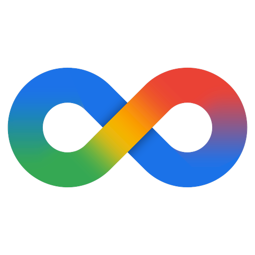

<div align="center">



# Gravityless

Yet Another Spicy Companion Of Antigravity

</div>

**English** | [简体中文](README.zh-CN.md)


Gravityless runs several isolated Antigravity instances side by side on Windows, manages a pool of Google accounts, and patches the app for native window materials.


## Prerequisites

- Windows 10 1809 or later
- [.NET 8 Desktop Runtime](https://dotnet.microsoft.com/download/dotnet/8.0)

---

## Features

| Area | What it does |
| --- | --- |
| Instances | Each instance gets its own `--user-data-dir` and redirected `USERPROFILE` / `APPDATA` / `LOCALAPPDATA` |
| Account pool | Captures OAuth credentials through a disposable sandbox, then enforces one account per running instance |
| Project memory | Per-project `brain/` and conversation databases, mounted on demand and forkable per step |
| Shared extensions | One `<install>\shared\` pool for skills, plugins and MCP, junctioned into every instance |
| Network | Direct, system proxy, or manual SOCKS5/HTTP/HTTPS, with a connectivity and entitlement probe |
| Core management | Stock detection, or managed download via the official update manifest with SHA512 verification |
| Materials | Mica, Tabbed and Acrylic backdrops injected into Antigravity, adjustable in real time |
| Tray and language | Stays in the tray when closed; switches both its own UI and the injected Antigravity UI between Chinese and English |

---

## Documentation

Full documentation lives in the [Wiki](https://github.com/Ra1nify/Gravityless/wiki).

| Page | Contents |
| --- | --- |
| [Overview](https://github.com/Ra1nify/Gravityless/wiki/Overview) | Versions, update checks, repository entry points |
| [Instances](https://github.com/Ra1nify/Gravityless/wiki/Instances) | Creating, binding, starting and stopping instances |
| [Projects](https://github.com/Ra1nify/Gravityless/wiki/Projects) | Import, fork, rename, memory store, conversations |
| [Tools](https://github.com/Ra1nify/Gravityless/wiki/Tools) | Skills, plugins and MCP shared pools |
| [Proxy](https://github.com/Ra1nify/Gravityless/wiki/Proxy) | Direct, system and manual proxy modes |
| [Accounts](https://github.com/Ra1nify/Gravityless/wiki/Accounts) | Capture, binding, mutex, quota refresh |
| [Appearance](https://github.com/Ra1nify/Gravityless/wiki/Appearance) | Materials, transparency, popup grain, skins, theme, language |
| [Multi-Instance](https://github.com/Ra1nify/Gravityless/wiki/Multi-Instance) | Why concurrent accounts are no longer possible |
| [Data-Layout](https://github.com/Ra1nify/Gravityless/wiki/Data-Layout) | Runtime directory structure and file meanings |
| [Troubleshooting](https://github.com/Ra1nify/Gravityless/wiki/Troubleshooting) | Common failures and how to handle them |

---

## Notes

- Gravityless patches the local Antigravity installation. It does not redistribute Google binaries.
- Antigravity 2.28 moved OAuth credentials into Windows Credential Manager under a single global entry. Separate accounts can no longer run at the same time; see [Multi-Instance](https://github.com/Ra1nify/Gravityless/wiki/Multi-Instance).
- The `data\` directory holds plaintext credentials. Treat it as sensitive, and back it up before moving or reinstalling.

---

## Build

Requires the .NET 8 SDK.

```powershell
dotnet build Gravityless.sln
dotnet run --project src\Gravityless.App\Gravityless.App.csproj
```

---

## License

GNU General Public License v3.0. See [LICENSE](LICENSE).

---

## Issues

Bug reports and feature requests are welcome in [Issues](../../issues).

When reporting a problem, include the Antigravity version from Overview, the Gravityless version, and the relevant lines from `Troubleshooting`.

---

s∞n
